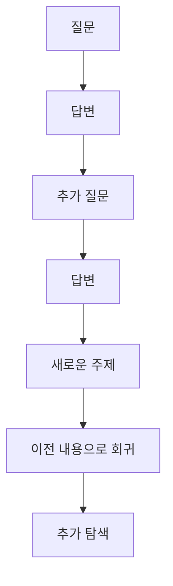

## 출발점

AI를 많이 사용하면서 점점 분명하게 느끼는 것이 있다.

AI는 인간과 비교하기 어려울 정도로 빠르게 정보를 찾고, 정리하고, 설명할 수 있다. 내가 전혀 모르는 분야라고 해도 몇 번의 검색과 대화만으로 관련 논문, 개념, 역사적 배경, 반론까지 빠르게 가져올 수 있다.

그런데 정보를 얻는 속도가 빨라진 만큼 내가 그 지식을 습득하는 속도가 빨라지는 것은 아니다.

AI 시대에는 오히려 새로운 종류의 병목이 나타난다.

> **지식의 병목이 정보에 대한 접근에서 지식의 구조화와 통합으로 이동하고 있다.**

AI 이전에는 필요한 정보를 찾는 것 자체가 상당한 비용이었다. 책을 찾고, 논문을 검색하고, 전문가의 설명을 듣고, 모르는 개념을 다시 조사해야 했다.

AI는 이 정보 접근 비용을 급격하게 낮췄다.

하지만 접근 비용이 낮아지고 나니 그 뒤에 있던 다른 문제가 더 선명하게 드러난다.

> **내가 실제로 처리할 수 있는 지식의 양에는 한계가 있다.**

## 정보가 존재하는 것, 접근 가능한 것, 나의 지식이 되는 것은 다르다

지식을 세 단계로 구분해 볼 수 있다.

### 1. 정보가 존재한다

어떤 논문, 책, 웹페이지, 영상 어딘가에 정보가 있다.

인터넷 이전에는 이 단계 자체가 큰 제약이었다.

### 2. 정보에 접근할 수 있다

검색 엔진과 AI가 이 문제를 크게 해결했다.

이제는 질문을 하면 AI가 수많은 자료를 검색하고 비교해서 몇 초 혹은 몇 분 안에 필요한 정보를 가져올 수 있다.

### 3. 정보가 나의 지식이 된다

여기서부터 문제가 달라진다.

정보를 읽었다고 해서 그것이 곧바로 내가 사용할 수 있는 지식이 되는 것은 아니다.

새로운 정보는 내가 이미 알고 있는 개념들과 연결되어야 하고, 중요한 것과 중요하지 않은 것이 구분되어야 하며, 여러 개념 사이의 관계가 만들어져야 한다.

그리고 그 전체가 내가 다시 떠올리고 사용할 수 있는 구조로 압축되어야 한다.

즉,

> **정보의 획득과 지식의 형성은 서로 다른 과정이다.**

AI는 앞의 두 단계를 획기적으로 가속하지만, 세 번째 단계에는 여전히 인간의 인지 과정이 깊게 개입한다.

최근 OpenAI가 나비에–스토크스 밀레니엄 문제의 해법을 제시하면서 수학계에서 벌어진 논쟁도 이 구분을 극단적으로 보여준다. AI가 증명을 만들어냈다고 해서 그것이 곧바로 인간의 수학적 이해가 되지는 않는다. 일부 수학자들은 난제를 푸는 과정에서 만들어지는 새로운 개념, 방법, 직관과 다른 문제로의 확장이야말로 수학 발전의 중요한 부분이라고 지적했다.

AI는 빠르게 정보에 접근할 수 있으며, 이제 인간이 모르는 정보조차 인간보다 먼저 찾을 수 있다. 하지만 그 답을 인간의 지식으로 만드는 과정은 여전히 남아 있다.

## 문제 1. 채팅 세션이라는 공간 자체의 한계

여기서 말하는 한계는 LLM의 context window 한계와는 조금 다르다.

최근의 AI는 매우 긴 컨텍스트를 처리할 수 있다. 따라서 모델이 기술적으로 얼마나 많은 토큰을 읽을 수 있는가는 점점 덜 중요한 문제가 되고 있다.

내가 더 크게 느끼는 문제는 사람과 AI가 만나는 인터페이스인 ‘채팅 세션’의 구조적 한계다.

채팅은 본질적으로 대화다.

대화는 시간축을 따라 흐른다.



그리고 대부분의 채팅 인터페이스는 이것을 하나의 긴 수직 스크롤로 표현한다.

짧은 하나의 문제를 해결할 때는 굉장히 좋은 인터페이스다.

하지만 내가 다루려는 지식이 커질수록 문제가 생긴다.

한 주제 안에서도 여러 개의 하위 개념이 생기고, 각 개념에서 다시 새로운 질문이 갈라진다. 과거에 했던 대화를 다시 참고해야 하고, 서로 멀리 떨어져 있는 내용 사이의 관계를 파악해야 한다.

> **지식은 점점 네트워크처럼 확장되는데 채팅은 계속 하나의 선으로 늘어난다.**

이 차이가 중요하다.

```text
실제 지식 구조

          B ─── D
        ↗ │
A ───── C ─── E
        ↘
          F ─── G


채팅 인터페이스

A → B → C → D → E → F → G → ...
```

따라서 모델이 이 모든 정보를 기억할 수 있다고 하더라도 사람이 그 대화를 탐색하고 전체 구조를 유지하기는 점점 어려워진다.

문서로 옮기면 이 문제를 어느 정도 해결할 수 있다.

문서는 목차, 제목, 링크, 표, 다이어그램 등을 통해 정보를 공간적으로 구조화할 수 있기 때문이다.

하지만 문서도 완전한 해결책은 아니다.

그 문서를 다시 탐구하거나 확장하려면 결국 AI와 대화해야 하고, 그 순간 다시 채팅 세션으로 돌아온다.

결국 다음과 같은 왕복이 발생한다.

```text
대화 → 문서화 → 문서 읽기 → 다시 대화 → 새로운 내용 → 문서 수정 → 다시 대화
```

> **현재의 AI 사용 환경에서는 대화 공간과 지식 공간이 분리되어 있다.**

이것이 긴 시간 동안 하나의 주제를 깊게 공부하거나 기획할 때 느껴지는 중요한 마찰 중 하나다.

## 문제 2. 인간에게도 ‘컨텍스트 윈도우’가 있다

더 근본적인 한계도 있다.

AI가 완벽하게 정리된 300페이지짜리 자료를 몇 분 만에 만들어줄 수 있다고 해도, 나는 그 300페이지를 한꺼번에 이해할 수 없다.

인간이 한 번에 처리하고 유지할 수 있는 정보에는 한계가 있다. 새로운 정보가 의미 있는 지식이 되려면 단순히 읽는 것에서 끝나는 것이 아니라, 내가 이미 가지고 있는 지식 구조 안에서 자리를 잡아야 한다.

이 논지와 닿아 있는 표현을 박문호는 일당백의 「박문호 박사가 들려주는 파편화된 지식의 한계? 감정, 인지, 운동 3중 루프의 비밀」 영상에서 다음과 같이 설명한다.

> “맥락은 지식의 허브가 연결된 것.”

그리고,

> “뼈대를 먼저 세우면 세부가 알아서 꽂힌다.”

전체적인 맥락과 지식의 뼈대가 먼저 존재해야 새로운 세부 지식이 들어갈 자리를 찾을 수 있다는 설명이다.

[일당백 원영상 보기](https://www.youtube.com/watch?v=eoEhMeQkGKE)

이 관점에서 보면 학습의 깊이는 얼마나 많은 정보를 접했는가보다, 새로운 정보를 기존의 지식 구조와 얼마나 잘 연결하고 재구성했는가에 더 크게 좌우된다.

나는 여기서 한 사람이 일정 시간 동안 새로운 정보를 기존 지식과 연결하고 실제로 자기 지식으로 만들어낼 수 있는 양을 **인지적 통합 처리량(cognitive integration throughput)**이라고 부르고 싶다.

이는 정식 학술 용어라기보다는 지금의 문제를 설명하기 위해 사용하는 개념이다.

AI가 한 시간 동안 100개의 새로운 정보를 공급할 수 있어도 내가 그중 5개만 기존 지식과 연결하고 실제로 소화할 수 있다면, 나의 실질적인 학습 속도를 결정하는 것은 AI의 정보 생성 속도가 아니라 나의 인지적 통합 처리량이다.

```text
AI가 공급할 수 있는 지식량
>>>>>>>>>>>>>>>>>>>>>>>>>>>>

인간이 통합할 수 있는 지식량
>>>>>
```

AI를 잘 사용할수록 역설적으로 이 차이는 더 커질 수 있다.

## 문제 3. AI는 지식을 너무 빠르게 공급한다

AI 이전에는 검색 자체에 마찰이 있었다.

한 가지를 공부하다 모르는 개념이 나오면 책을 찾거나 검색을 해야 했다. 이 비용 때문에 자연스럽게 학습의 속도가 제한되었다.

AI는 그 마찰을 없앤다.

하나의 질문을 하면 새로운 개념 다섯 개가 나온다.

그중 하나를 질문하면 관련 연구 열 개가 나온다.

그 연구를 조사하면 또 다른 이론과 사람이 나온다.

몇 번만 반복하면 내가 처음 공부하려던 범위를 훨씬 넘어선다.

따라서 AI 시대에는 새로운 문제가 발생한다.

정보 부족보다 정보 공급 속도가 인간의 지식 통합 속도를 초과하는 문제가 더 중요해질 수 있다.

AI를 잘 쓰는 능력이 오히려 이 문제를 더 빠르게 만들어낸다.

## Compression의 중요성

그래서 중요한 능력이 compression, 즉 압축이다.

여기서 압축은 단순히 긴 글을 짧게 만드는 것이 아니다.

많은 사실과 사례에서 중요한 개념을 선택하고, 관계를 만들고, 하나의 구조로 추상화하는 과정이다.

최근에 본 Thinking Sian의 블로그 글 「AI에게 절대로 의존해서는 안 되는 능력 – 요약」에서는 요약을 사실상 추상화 능력으로 본다.

특히 다음 문장이 이 문제와 정확히 연결된다.

> “추상화된 아이디어는 내가 갖고 있는 멘탈 모델에 연결하기 쉽다.”

즉 압축의 목적은 정보를 버리는 것만이 아니다.

새로운 정보를 기존의 멘탈 모델에 연결할 수 있는 형태로 변환하는 것이다.

[Thinking Sian, 「AI에게 절대로 의존해서는 안 되는 능력 – 요약」](https://thinkingsian.com/skills-never-to-delegate-to-ai-summary)

이 점에서 AI에게 압축 자체를 맡기는 것은 문제가 될 수 있다.

AI는 인간보다 훨씬 빠르고 매끄럽게 요약할 수 있다. 하지만 학습이라는 관점에서는 압축된 결과물을 얻는 것과 압축하는 능력을 기르는 것은 전혀 다른 문제다.

운동선수가 로봇이 자신보다 아령을 훨씬 잘 든다는 이유로 대신 들어달라고 하면 근육이 자라지 않는 것과 비슷하다.

압축도 마찬가지다.

무엇이 중요한지 선택하고, 여러 사실에서 공통된 구조를 발견하고, 불필요한 것을 버리고, 자기 언어로 다시 표현하는 과정 자체가 인지 훈련이다.

따라서 학습을 목적으로 한다면 AI가 해야 할 일은 압축을 대신 수행하는 것보다, 인간이 직접 압축할 수 있도록 돕는 것이다.

예를 들면 이런 식이다.

- 놓친 중요한 정보가 있는지 알려준다.
- 서로 충돌하는 근거를 보여준다.
- “이 내용을 한 문장으로 설명한다면?” 같은 질문을 던진다.
- 내가 만든 요약에서 논리적 비약이나 왜곡을 지적한다.
- 내 설명을 보고 무엇이 아직 불명확한지 되묻는다.

최종적으로 무엇을 남기고 어떤 구조로 이해할지는 인간이 결정해야 한다.

특히 중요한 지식일수록 인간이 직접 다음 질문을 거쳐야 한다.

- 이 내용에서 정말 중요한 것은 무엇인가?
- 이것을 한 문장으로 표현하면 무엇인가?
- 내가 이미 알고 있는 어떤 개념과 연결되는가?
- 이전 생각 중 무엇을 수정해야 하는가?
- 이 지식을 다른 문제에 적용할 수 있는가?

> **압축의 결과보다 압축하는 과정 자체가 학습이다.**

## 새로운 병목: 지식 통합 시스템

따라서 AI 시대의 학습 생산성을 이렇게 생각해볼 수 있다.

```text
과거

정보 탐색 → 이해 → 기억 → 활용
████████   ███    ██     ██
병목


AI 시대

정보 탐색 → 구조화 → 압축 → 연결 → 이해 → 활용
█           ████     ████   ████   ███    ███
                      병목
```

검색과 정보 수집의 비용은 급격하게 감소한다.

그 결과 상대적으로 중요해지는 것은 다음 능력이다.

> **많은 정보를 어떤 구조로 받아들이고, 무엇을 버리고, 무엇을 압축하고, 기존 지식과 어떻게 연결할 것인지를 설계하는 능력.**

이를 지식 통합 시스템 설계 능력이라고 부를 수 있다.

AI 시대에 AI를 잘 쓴다는 것은 점점 좋은 프롬프트를 작성하거나 많은 정보를 검색하는 것만을 의미하지 않게 될 것이다.

AI가 만들어내는 압도적인 정보량과 인간의 제한된 인지적 통합 처리량 사이를 어떻게 연결할 것인가가 더 중요한 문제가 된다.

## 핵심 명제

> **AI는 지식에 대한 접근 비용을 거의 제거하고 있지만, 지식을 인간의 인지 구조 안으로 통합하는 비용까지 제거하지는 못한다.**

> **따라서 AI 시대의 새로운 지식 병목은 정보 검색보다 구조화, 압축, 연결, 그리고 인지적 통합에 있다.**

그리고 여기서 한 단계 더 나아가면 다음과 같은 주장을 할 수 있다.

> **AI 시대의 중요한 역량은 정보 검색 능력에서 지식 통합 시스템 설계 능력으로 이동한다.**
