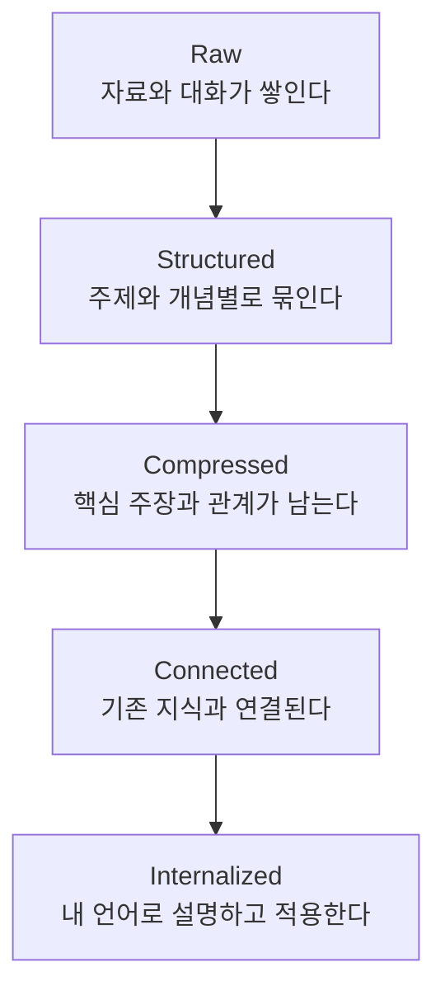
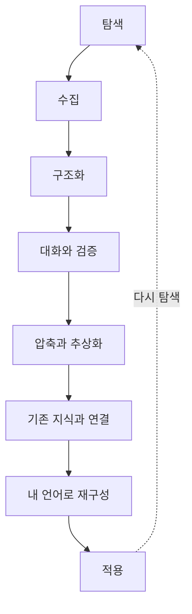

이 문제에서 AI-native note를 생각해볼 수 있다.

현재 AI 사용의 기본 단위는 conversation이다.

반면 장기적인 학습의 기본 단위는 conversation이라고 보기 어렵다.

몇 달 동안 AI와 수백 번 대화했다고 해서 그 대화 기록 자체가 나의 지식 체계가 되는 것은 아니다.

여기서 중요한 구분이 생긴다.

> **Chat history와 knowledge state는 다르다.**

Chat history는 내가 AI와 무엇을 이야기했는지를 기록한다.

Knowledge state는 그 결과 내가 지금 무엇을 알고 있고, 어떤 개념들이 어떤 관계를 맺고 있으며, 무엇을 아직 모르는지를 표현한다.

AI-native note가 다뤄야 하는 것은 후자다.

## 채팅을 없애는 것이 아니라 역할을 바꿔야 한다

대화는 여전히 매우 강력하다.

질문하고, 반론을 받고, 아이디어를 발전시키고, 모르는 부분을 파고드는 데 채팅만큼 자연스러운 인터페이스는 드물다.

문제는 채팅이 모든 지식의 저장소까지 담당하고 있다는 것이다.

AI-native note에서는 두 공간을 분리할 필요가 있다.

### Dialogue Space

AI와 자유롭게 탐색하는 공간.

- 질문
- 탐색
- 브레인스토밍
- 반론
- 비교
- 깊이 파기

여기서는 대화의 시간축이 장점이다.

### Knowledge Space

지금까지 탐색한 결과를 구조화하는 공간.

- 핵심 개념
- 개념 사이의 관계
- 주장
- 근거
- 출처
- 내가 가진 생각
- 아직 해결되지 않은 질문
- 다른 노트와의 연결

이 공간에는 반드시 시간 순서로 정보가 배치될 필요가 없다.

지식의 구조에 따라 배치되어야 한다.

## 하나의 거대한 컨텍스트보다 ‘현재의 지식 구조’가 필요하다

AI-native note가 해결해야 할 문제를 단순히 다음과 같이 생각해서는 안 된다.

> 모든 문서와 모든 채팅을 AI에게 넣어주면 된다.

모델 입장에서는 가능할 수 있다.

하지만 인간 입장에서는 여전히 전체를 볼 수 없다.

오히려 필요한 것은 AI가 거대한 컨텍스트를 가지고 있으면서 사용자에게는 현재 필요한 구조만 보여주는 것이다.

즉,

> **AI는 많이 기억하고, 인간은 적지만 구조화된 것을 본다.**

예를 들어 특정 주제를 공부하고 있다면 사용자가 항상 보아야 하는 것은 모든 대화가 아니라 이런 것일 수 있다.

```text
현재 주제
│
├─ 핵심 개념
│   ├─ A
│   ├─ B
│   └─ C
│
├─ 지금까지의 결론
│
├─ 중요한 근거
│
├─ 내가 아직 이해하지 못한 부분
│
└─ 다음에 탐색할 질문
```

그리고 각 항목에서 필요할 때만 다시 대화를 열어 깊게 들어간다.

## 대화는 노드에 붙어야 한다

현재의 채팅에서는 모든 대화가 하나의 긴 timeline에 붙는다.

AI-native note에서는 오히려 지식의 특정 노드에서 대화가 시작되는 구조가 자연스럽다.

예를 들어,

```text
[인지 부하 이론]
      │
      ├── 개념 설명
      ├── 관련 논문
      ├── 내 생각
      └── 💬 이 개념에 대한 대화
```

내가 ‘인지 부하 이론’을 선택하고 AI와 대화를 하면 그 대화의 기본 컨텍스트는 전체 채팅 기록이 아니라 해당 노드와 연결된 자료가 된다.

다른 날 다시 돌아와도 긴 채팅을 스크롤할 필요가 없다.

노드를 선택하면 그 지식에 필요한 맥락으로 다시 진입할 수 있다.

이렇게 되면 대화는 지식을 담는 컨테이너가 아니라 지식을 탐색하는 도구가 된다.

## 지식 형성의 핵심 과정은 인간에게 남겨야 한다

AI-native note에서 중요한 디자인 원칙 중 하나는 학습에 필요한 핵심 인지 작업을 모두 AI에게 넘기지 않는 것이다.

AI는 이미 자료를 찾고, 비교하고, 설명하고, 요약하고, 구조화하는 일을 매우 잘한다.

하지만 AI가 잘할 수 있다는 것과 그 일을 인간이 직접 수행할 필요가 없다는 것은 다른 문제다.

학습의 관점에서 중요한 것은 최종 결과물만 얻는 것이 아니라, 그 과정에서 인간이

- 무엇이 중요한지 선택하고,
- 여러 정보를 관계에 따라 구조화하고,
- 공통된 개념을 추상화하고,
- 핵심을 요약하고 압축하고,
- 기존 지식과 연결하고,
- 자신의 언어로 다시 표현하는

인지 작업을 수행하는 것이다.

따라서 AI-native note에서는 역할을 다음처럼 나누는 것이 좋다.

### AI가 해야 하는 것

- 필요한 자료를 찾는다.
- 출처와 근거를 모은다.
- 서로 다른 관점을 비교해 보여준다.
- 어려운 개념을 다양한 방식으로 설명한다.
- 과거의 관련 노트를 찾아준다.
- 연결될 가능성이 있는 기존 지식을 보여준다.
- 내가 놓친 근거나 반례를 지적한다.
- 모순이나 논리적 빈틈을 찾아준다.
- 내가 직접 생각할 수 있도록 질문한다.
- 내가 만든 구조, 요약, 설명에 피드백한다.

### 인간이 해야 하는 것

- 무엇이 중요한지 선택한다.
- 무엇을 버릴지 결정한다.
- 여러 정보를 하나의 구조로 묶는다.
- 핵심을 요약하고 압축한다.
- 공통된 개념과 관계를 추상화한다.
- 자기 언어로 다시 표현한다.
- 기존 지식과 연결한다.
- 최종적인 지식 구조를 만든다.
- 자신의 입장을 결정한다.
- 실제 문제에 적용한다.

AI의 역할은 인간이 해야 할 사고를 없애는 것이 아니라, 불필요한 탐색 비용과 반복 작업을 줄이고 중요한 사고에 더 많은 인지 자원을 사용할 수 있도록 돕는 것에 가깝다.

## Progressive Compression

노트는 처음부터 완벽하게 압축될 필요도 없다.

하나의 주제를 공부하면서 다음 단계를 거칠 수 있다.



AI-native note는 이 과정을 지원해야 한다.

다만 이 변환 과정에서 일어나는 선택·구조화·압축·추상화·연결은 그 자체로 중요한 학습 과정이다.

AI는 Raw 단계에서 관련 자료를 찾고, Structured 단계에서 빠진 관점을 알려주고, Compressed 단계에서 내가 만든 요약의 빈틈을 지적하고, Connected 단계에서는 연결 가능한 기존 노트를 찾아줄 수 있다.

하지만 정보가 어떤 구조를 이루고 무엇이 핵심이며 기존 지식과 어떻게 연결되는지를 판단하는 과정까지 모두 자동화하면, 결과물은 남아도 그 구조가 인간 자신의 지식 구조로 형성되지 않을 수 있다.

중요한 것은 최종 요약본 하나를 AI가 만들어주는 것이 아니다.

> **정보가 점점 나의 지식 구조로 변환되는 과정 자체가 제품의 핵심 경험이어야 한다.**

## ‘현재 이해 상태’를 저장하는 노트

일반적인 노트 앱은 정보를 저장한다.

AI-native note는 한 단계 더 나아가 사용자의 이해 상태를 저장할 수 있다.

예를 들어 하나의 주제에 다음과 같은 상태가 존재할 수 있다.

```markdown
### 내가 이해한 것
- ...

### 아직 애매한 것
- ...

### 기존 생각과 충돌하는 것
- ...

### 핵심 개념
- ...

### 연결된 지식
- ...

### 근거
- ...

### 다음 질문
- ...
```

그러면 AI는 단순히 “이 주제에 대해 무엇을 알고 있는가?”가 아니라,

> “내가 이 주제를 어디까지 이해하고 있는가?”

를 컨텍스트로 사용할 수 있다.

이것이 chat history와 knowledge state의 가장 큰 차이다.

## AI-native note의 기본 루프

결국 제품의 핵심 루프는 이런 형태가 될 가능성이 있다.



현재의 ChatGPT는 이 중 탐색과 대화에 매우 강하다.

Obsidian 같은 PKM은 저장과 연결에 강하다.

AI-native note가 만들 수 있는 새로운 경험은 이 사이를 연결하면서도, 지식이 인간 자신의 구조로 형성되기 위해 필요한 인지 과정은 인간에게 남겨두는 것이다.

## 제품 관점에서 가장 중요한 한 문장

> **AI-native note가 해결하려는 핵심 문제는 Human knowledge integration이다.**

그리고 이것은 앞에서 이야기한 변화와 그대로 연결된다.

AI 시대의 핵심 역량이 정보 검색 능력에서 지식 통합 시스템 설계 능력으로 이동한다면, AI-native note는 바로 그 지식 통합 시스템의 인터페이스가 될 수 있다.

따라서 AI-native note의 목표는 다음과 같다.

> **AI-native note는 AI를 통해 더 많은 정보를 저장하는 시스템이 아니라, 인간이 AI가 공급하는 방대한 지식을 선택하고 구조화하고 압축하고 연결하여 자신의 지식 구조로 통합할 수 있도록 돕는 시스템이어야 한다.**

<!-- toggle: 부록. 관련 이론과 추가 레퍼런스 -->

본문의 문제의식은 개인적인 AI 사용 경험에서 출발했다. 아래 자료들은 이 생각을 정리한 뒤 AI를 활용해 추가로 찾아본 학습과학 및 교육심리학의 관련 연구들이다. 본문의 직접적인 출발점은 아니지만, 일부 주장과 연결되는 학술적 배경을 제공한다.

## A. 인지부하 이론과 지식 구조

### Cognitive Load Theory

**인지부하 이론(Cognitive Load Theory, CLT)**은 John Sweller가 1980년대부터 발전시킨 교육심리학 이론이다.

이 이론의 중요한 전제 중 하나는 새로운 정보를 의식적으로 처리하는 작업기억(working memory)의 용량은 제한적인 반면, 장기기억에는 조직화된 지식 구조를 축적할 수 있다는 것이다.

숙련자가 복잡한 문제를 초보자보다 쉽게 처리할 수 있는 이유도 단순히 더 많은 개별 사실을 기억하기 때문만은 아니다. 여러 정보를 의미 있는 하나의 구조로 묶어 처리할 수 있기 때문이다.

이러한 조직화된 지식 구조를 인지부하 이론에서는 주로 schema라는 개념으로 설명한다.

학습이 진행되면 개별 정보들이 서로 연결되어 schema가 형성되고, 이를 통해 제한된 작업기억을 보다 효율적으로 사용할 수 있게 된다.

이 관점은 본문에서 말한 다음 생각과 연결된다.

> 새로운 정보를 얼마나 많이 접했는가보다, 그것을 기존의 지식 구조와 얼마나 잘 연결하고 조직했는가가 중요하다.

대표 레퍼런스:

- John Sweller, Cognitive Load During Problem Solving: Effects on Learning (1988)\
  <https://doi.org/10.1207/s15516709cog1202_4>
- John Sweller, Jeroen J. G. van Merriënboer, Fred G. W. C. Paas, Cognitive Architecture and Instructional Design (1998)\
  <https://doi.org/10.1023/A:1022193728205>

다만 본문에서 사용하는 **인지적 통합 처리량(cognitive integration throughput)**은 인지부하 이론의 공식 용어가 아니다. 작업기억의 제약, schema 형성, 기존 지식과의 연결이라는 아이디어에서 영감을 받아 현재의 문제를 설명하기 위해 임시로 사용하는 표현이다.

## B. Generative Learning

Thinking Sian의 글을 읽은 뒤 찾아본 관련 연구 가운데 본문의 문제의식과 가장 가까운 분야는 Generative Learning이다.

Generative Learning은 학습자가 정보를 수동적으로 받아들이기보다, 새로운 정보에 대해 적극적인 인지 활동을 할 때 더 깊은 학습이 일어난다고 본다.

Fiorella와 Mayer는 이를 크게 세 가지 과정으로 설명한다.

```text
선택 Select
↓
중요한 정보를 고른다.

구조화 Organize
↓
선택한 정보 사이의 관계와 구조를 만든다.

통합 Integrate
↓
새로운 정보를 기존 지식과 연결한다.
```

이 틀은 Thinking Sian이 말한 “추상화된 아이디어를 기존 멘탈 모델에 연결한다”는 설명과 상당히 닮아 있다.

대표 레퍼런스:

- Logan Fiorella & Richard E. Mayer, Learning as a Generative Activity: Eight Learning Strategies that Promote Understanding (2015)\
  이 책에서는 다음과 같은 활동들을 generative learning 전략으로 다룬다.
  - summarizing
  - mapping
  - drawing
  - imagining
  - self-testing
  - self-explaining
  - teaching
  - enacting

중요한 점은 이 활동의 최종 결과물이 아니라 학습자가 정보를 선택하고, 조직하고, 기존 지식과 통합하는 인지 과정이다.

## C. Generation Effect

Generative Learning과 연결되는 고전적인 연구로 generation effect가 있다.

사람은 완성된 정보를 단순히 읽는 것보다, 일부 정보를 직접 생성했을 때 더 잘 기억하는 경향을 보인다.

대표적인 초기 연구:

- Norman J. Slamecka & Peter Graf, The Generation Effect: Delineation of a Phenomenon (1978)\
  <https://doi.org/10.1037/0278-7393.4.6.592>

이 연구는 “직접 생성하는 과정 자체가 기억과 학습에 영향을 준다”는 점을 보여준다.

AI 시대에는 이 관점이 새로운 의미를 갖는다.

AI가 요약, 설명, 답안, 구조화까지 대신 수행할 수 있기 때문에, 과거에는 자연스럽게 인간이 수행하던 generation 과정 자체가 AI로 이전될 수 있기 때문이다.

따라서 중요한 것은 결과물의 존재만이 아니라, 그 결과물을 만드는 과정에서 학습자가 실제로 어떤 인지 활동을 수행했는가이다.

## D. 요약은 항상 좋은 학습법인가?

Thinking Sian의 글은 요약을 추상화와 사고 훈련의 관점에서 긍정적으로 다룬다.

다만 학습과학 연구에서는 요약이라는 행위 자체가 항상 효과적인 것은 아니다.

Dunlosky 등의 2013년 리뷰는 여러 학습법의 효과를 비교하면서 summarization을 상대적으로 낮은 utility의 학습 전략으로 평가했다.

- John Dunlosky et al., Improving Students’ Learning With Effective Learning Techniques: Promising Directions From Cognitive and Educational Psychology (2013)\
  <https://journals.sagepub.com/doi/10.1177/1529100612453266>

특히 요약은 학습자가 이미 좋은 요약 능력을 갖고 있는지, 적절한 훈련을 받았는지, 어떤 종류의 자료를 다루는지에 따라 효과가 크게 달라진다.

따라서 본문에서 중요한 것은 단순히

> “요약을 직접 해야 한다.”

가 아니라,

> **중요한 정보를 선택하고, 구조화하고, 추상화하고, 기존 지식과 연결하는 인지 작업을 인간이 직접 수행해야 한다.**

는 주장에 가깝다.

## E. Generative AI와 ‘누가 사고하는가’

GenAI가 보편화되면서 Generative Learning의 관점에서 새로운 문제가 등장하고 있다.

과거에는 학습자가 직접 해야 했던

- 설명
- 요약
- 비교
- 개념지도 작성
- 문제 풀이
- 질문 생성

등의 활동을 이제 AI가 대신할 수 있기 때문이다.

따라서 중요한 질문이 생긴다.

> **결과물이 만들어졌는가보다, 그 결과물을 만들기 위한 인지 작업을 누가 수행했는가가 중요하지 않은가?**

### Generative-learning 기반 AI tutor

2025년 Educational Psychology Review에 발표된 Makransky 등의 연구는 일반적인 ChatGPT 사용과, 학습자가 AI에게 직접 설명하고 가르치도록 유도하는 generative-learning 기반 AI tutor를 비교했다.

연구에서는 단순히 AI에게 답을 받는 방식보다 사용자가 직접 설명하고 생성하는 인지 활동을 포함시킨 방식이 개념적 지식 학습에서 더 좋은 결과를 보였다.

- Makransky et al. (2025)\
  <https://doi.org/10.1007/s10648-025-10039-x>

이는 AI가 학습자의 사고를 대신하기보다 사고를 유도하는 역할을 해야 할 가능성을 보여준다.

### Locus of Generation

2026년 발표된 관련 연구에서는 이 문제를 locus of generation, 즉 생성이 실제로 어디에서 일어나는가라는 관점에서 다룬다.

AI가 설명과 요약을 생성했다고 해서 인간에게 동일한 학습이 발생했다고 볼 수는 없다.

- Cho (2026), Educational Psychology Review\
  <https://link.springer.com/article/10.1007/s10648-026-10210-y>

이 개념은 AI-native note를 설계할 때 특히 중요하다.

좋은 AI 학습 시스템은 사용자의 모든 인지 작업을 대신 수행하기보다,

> **어떤 작업은 AI가 제거하고, 어떤 작업은 의도적으로 인간에게 남겨야 하는가**

를 설계해야 한다.

학습에서 중요한 것은 단순한 결과물 생산이 아니라 인간에게 어떤 인지적 변화가 일어났는가이기 때문이다.

## F. 박문호 — 파편화된 지식과 맥락

본문에서 인용한 박문호의 일당백 영상 「파편화된 지식의 한계? 감정, 인지, 운동 3중 루프의 비밀」에서는 정보를 많이 접하는 것과 그것이 하나의 맥락 있는 지식 구조를 이루는 것은 다르다는 문제를 다룬다.

영상에서 박문호는 다음과 같이 표현한다.

> “맥락은 지식의 허브가 연결된 것.”

또한,

> “뼈대를 먼저 세우면 세부가 알아서 꽂힌다.”

핵심은 개별적인 정보가 많다고 해서 자동으로 깊은 이해가 생기는 것은 아니라는 점이다. 먼저 전체적인 뼈대와 지식의 허브가 형성되어 있어야 새로운 세부 정보가 그 안에서 위치를 찾고 다른 지식과 연결될 수 있다.

영상에서는 이 문제를 단순한 지식 습득에만 한정하지 않고 기억, 감정, 운동, 인지의 관계까지 확장해서 설명한다.

### 기억과 맥락

박문호의 설명에서 기억은 단순한 정보 저장소가 아니다.

머릿속에 이미 존재하는 기억과 지식이 있어야 새로운 정보를 비교하고 연결할 수 있다. 기억이 지식의 허브가 되고, 허브들이 서로 연결되면서 맥락이 만들어진다는 것이다.

이 관점에서는 검색을 통해 언제든 정보를 다시 찾을 수 있다는 사실만으로 인간 내부의 기억이 불필요해지는 것은 아니다.

오히려 기억은 새로운 정보가 연결될 수 있는 내부 구조의 역할을 한다.

### 감정·인지·운동의 3중 루프

영상에서는 인간의 활동을 **감정(emotional)·인지(cognitive)·운동(motor)**이 서로 연결된 3중 루프로 설명한다.

운동을 예로 들면 몸을 움직이는 운동 기능뿐 아니라 상황을 판단하는 인지와, 긴장·성취감·즐거움 같은 감정이 동시에 작동한다.

이 세 가지는 실제 경험 속에서 분리되어 있지 않다.

따라서 학습 역시 머릿속에서 정보를 받아들이는 인지 활동만으로 이루어진다고 보기 어렵다. 직접 행동하고, 실패하고, 감정을 경험하며 형성된 기억 역시 이후의 사고와 학습에 영향을 준다는 것이 영상의 중요한 논지다.

### 디지털 환경과 파편화

영상에서는 스마트폰을 통해 정보와 기억을 외부화하는 현상도 다룬다.

문제는 단순히 스마트폰을 많이 사용한다거나 집중 시간이 짧아진다는 데 있지 않다.

정보를 계속해서 빠르게 접하는 반면, 하나의 정보를 기억하고 다른 지식과 연결하면서 맥락을 형성하는 과정이 줄어들 수 있다는 것이 더 근본적인 문제로 제시된다.

이 부분은 AI 시대의 학습 문제와도 연결해서 볼 수 있다.

AI는 검색뿐 아니라 기억, 비교, 설명, 요약까지 외부화할 수 있기 때문이다. 따라서 외부 시스템이 더 많은 인지 작업을 수행할 수 있게 될수록,

> **어떤 인지 활동을 외부에 맡기고, 어떤 인지 활동은 인간 내부에 남겨야 하는가**

라는 문제가 중요해진다.

본문에서 말한 Human knowledge integration 역시 같은 문제의 연장선에서 볼 수 있다.

AI가 더 많은 정보를 더 빠르게 공급할수록 인간에게 필요한 것은 단순한 정보 접근 능력보다, 지식의 뼈대를 만들고 새로운 정보를 기존 지식과 연결해 하나의 맥락으로 만드는 능력일 수 있다.

참고 자료:

- 박문호, 일당백 「파편화된 지식의 한계? 감정, 인지, 운동 3중 루프의 비밀」\
  <https://www.youtube.com/watch?v=eoEhMeQkGKE>

## G. OpenAI의 나비에–스토크스 해법과 ‘문제를 푼다’는 것의 의미

2026년 9월 8일 OpenAI는 내부 AI 시스템이 나비에–스토크스 방정식의 존재성과 매끄러움 문제에 대한 해법을 도출했다고 발표했다. 이 문제는 클레이 수학연구소가 지정한 7개의 밀레니엄 문제 중 하나로, 약 90년 동안 미해결 상태였다.

OpenAI의 시스템은 약 10,000개의 에이전트를 동시에 활용해 문제를 탐색했고, 최종적으로 유한 시간 안에 특이점이 발생할 수 있음을 보이는 증명과 Lean 형식 증명을 공개했다. OpenAI에 따르면 나비에–스토크스 문제에만 약 270만 건의 에이전트 메시지와 1,300억 개의 출력 토큰이 사용됐다.

이 결과는 AI의 수학적 능력을 보여주는 상당한 성취였지만, 동시에 수학계에서는 **‘난제를 해결한다는 것이 수학에서 무엇을 의미하는가’**라는 논쟁을 촉발했다.

### 문제를 푸는 것은 원래 무엇을 의미했는가

OpenAI 발표 사흘 뒤인 9월 11일, 다수의 필즈상 수상자들이 참여한 공개 선언 「A Severe Misalignment of AI in Mathematics」가 발표됐다.

이 선언은 유명한 난제들이 단순히 정답을 기다리는 문제 목록이 아니었다고 설명한다.

역사적으로 중요한 난제는 수학적 세계에서 아직 충분히 이해하지 못한 영역을 표시하는 ‘landmarks and lighthouses’, 즉 지식의 지형에서 일종의 이정표와 등대 역할을 해왔다.

그리고 그런 문제를 해결한다는 것은 대개 그 과정에서

- 새로운 개념이 만들어지고
- 새로운 증명 방법이 발견되고
- 기존 영역 사이의 관계가 드러나고
- 여러 수학자가 결과를 토론하고 단순화하고
- 이후 다른 문제에 재사용할 수 있는 수학적 도구가 만들어지는

과정을 동반했다.

공개 선언은 이를 다음과 같이 압축한다.

> “Solving problems is only a tool and proxy for achieving the primary goal of conceptual understanding and insight.”

즉 문제를 푸는 것 자체가 최종 목적이라기보다, 개념적 이해와 통찰이 깊어졌음을 보여주는 하나의 지표였다는 주장이다.

### AI는 ‘문제 해결’과 ‘이해’를 분리할 수 있다

기존에는 매우 어려운 난제가 해결되면 그 과정에서 새로운 이해가 생겼을 가능성이 높았다.

따라서 대략 다음과 같은 관계가 있었다.

```text
오랜 문제 탐구
 ↓
새로운 개념과 방법
 ↓
더 깊은 이해
 ↓
난제 해결
 ↓
방법의 단순화·일반화·다른 영역으로의 확장
```

하지만 AI는 이 관계를 끊을 수 있다.

OpenAI의 나비에–스토크스 프로젝트처럼 방대한 계산 자원과 수많은 에이전트가 거대한 탐색 공간을 병렬적으로 탐색하면, 인간 공동체가 문제를 이해해가는 속도보다 훨씬 빠르게 최종 증명이 먼저 도착할 수 있기 때문이다.

그 결과 다음과 같은 상태가 가능해진다.

```text
난제
 ↓
AI의 대규모 탐색
 ↓
증명

하지만 인간에게는

새로운 직관 ?
새로운 개념 ?
새로운 방법의 일반화 ?
다른 영역과의 연결 ?
```

증명이 참이라는 것과, 그 증명이 인간의 수학적 이해를 얼마나 확장했는가는 서로 다른 질문이 되는 것이다.

공개 선언은 AI가 빠른 속도로 참/거짓 결과를 대량 생산할 경우, 새로운 아이디어가 성장할 수 있는 수학적 ‘비옥한 토양’ 자체를 훼손할 수도 있다고 우려한다. 특히 AI가 만든 결과 역시 결국 인간 수학자들이 해석하고, 핵심 아이디어를 분리하고, 기존 수학과 연결하고, 교육 가능한 형태로 다시 정리해야 수학적 지식 체계 안에 자리 잡을 수 있다고 주장한다.

### 실패한 탐구조차 지식 형성의 일부다

이 논쟁에서 흥미로운 사례를 수학자 Timothy Gowers가 들었다.

Gowers는 어린 시절 페르마의 마지막 정리를 직접 풀려고 시도했지만 당연히 실패했다. 그러나 그 과정에서 차분 수열의 규칙을 스스로 발견했고, 훗날 같은 내용을 정식으로 배울 때 훨씬 깊게 이해할 수 있었다고 회고한다.

그는 이를 두고 문제를 실제로 해결하지 못하더라도 문제를 오래 생각하는 과정에서 많은 것을 배울 수 있다는 사례라고 설명한다.

이것은 학습에서도 중요한 구분이다.

> **정답을 얻는 것 ≠ 문제를 풀 수 있는 사람이 되는 것**

마찬가지로,

> **증명을 얻는 것 ≠ 그 수학을 이해하는 것**

일 수 있다.

### 수학계 내부에도 다른 관점은 있다

다만 “수학의 진짜 목적은 개념적 이해이고 문제 해결은 단지 수단이다”라는 주장 자체가 수학계 전체의 합의인 것은 아니다.

Gowers는 바로 이 이유 때문에 해당 선언에 서명하지 않았다고 설명한다. 그는 수학자들 사이에는 문제 해결 자체를 주요 목표로 보는 사람과, 개념적 이해를 주요 목표로 보는 사람이 연속적으로 존재하며 둘 다 수학에 기여해왔다고 지적한다.

따라서 AI가 난제를 해결하는 것 자체가 의미 없다는 결론을 내릴 필요는 없다.

오히려 새로운 문제가 생긴 것으로 보는 편이 정확하다.

과거에는 ‘문제를 해결했다’와 ‘인간의 이해가 진전됐다’가 강하게 묶여 있었지만, AI는 이 둘을 분리할 수 있게 만들었다.

그래서 앞으로는 난제의 해결 여부뿐 아니라,

- AI의 증명에서 새로운 핵심 아이디어를 추출할 수 있는가
- 그 아이디어를 인간이 이해할 수 있는 형태로 압축할 수 있는가
- 기존 수학의 지식 구조와 연결할 수 있는가
- 다른 문제나 다른 분야로 일반화할 수 있는가
- 다음 세대의 수학자가 사용할 수 있는 새로운 도구로 만들 수 있는가

가 별도의 중요한 작업이 된다.

### 이 문서의 문제의식과의 연결

이 논쟁은 본문에서 말한 정보의 획득과 지식의 형성은 다르다는 구분을 극단적인 형태로 보여준다.

AI가 난제의 증명을 만들어내는 것은 일종의 ‘정보 획득’에 해당할 수 있다.

그러나 그 결과가 인간의 수학적 지식이 되려면 여전히

```text
증명
 ↓
핵심 아이디어의 선택
 ↓
구조화
 ↓
압축·추상화
 ↓
기존 수학과의 연결
 ↓
일반화와 적용
 ↓
인간의 지식 체계에 통합
```

이라는 과정이 필요하다.

OpenAI의 나비에–스토크스 사례가 흥미로운 이유는 AI가 인간의 지식 형성 속도를 뛰어넘어 결과를 공급하기 시작하면 어떤 일이 생기는지를 학습보다 훨씬 큰 규모에서 보여주기 때문이다.

본문에서 말한 ‘인지적 통합 처리량’의 문제를 수학 공동체 전체의 수준으로 확대해 생각할 수도 있다.

AI가 새로운 결과를 만들어내는 처리량이 인간 공동체가 그 결과를 이해하고 구조화하고 기존 지식에 통합하는 처리량보다 커지기 시작한 것이다.

따라서 AI 시대의 과제는 단순히 더 많은 난제를 더 빨리 푸는 것만이 아닐 수 있다.

AI가 만들어낸 결과를 인간이 이해하고, 압축하고, 연결하고, 다시 사용할 수 있는 지식으로 바꾸는 것이 새로운 병목이 된다.

이 점에서 나비에–스토크스 논쟁은 본문에서 말한 Human knowledge integration의 문제를 개인의 학습 수준이 아니라 학문 공동체 전체의 지식 형성 과정에서 보여주는 사례라고 볼 수 있다.

참고 자료:

- OpenAI, 「On the Navier–Stokes Millennium Prize Problem」, 2026-09-08.
- 「A Severe Misalignment of AI in Mathematics」, 2026-09-11. 다수의 필즈상 수상자들이 참여한 공개 선언.
- Timothy Gowers, 「Why I didn’t sign the Fields medallists’ letter」, 2026-09-17. 문제 해결과 개념적 이해의 관계에 대한 보완적 관점.

<!-- /toggle -->
